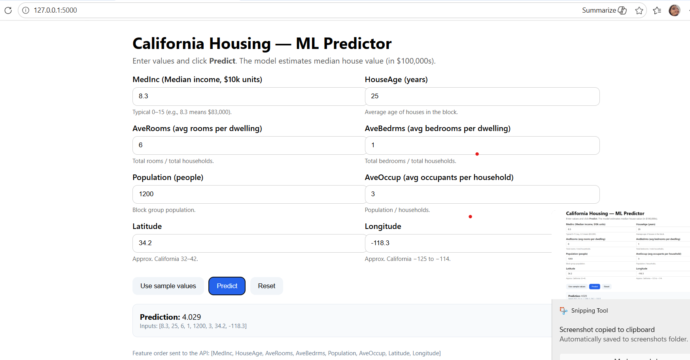

# Model as a Service ด้วย Flask และ Docker

งานในรายวิชา CPE312 Data Science: นำโมเดล Machine Learning ที่ทำนายราคาบ้านใน California มาให้บริการผ่านเว็บและ API ด้วย Flask แล้วห่อด้วย Docker เพื่อให้รันได้เหมือนกันทุกเครื่อง

- **โมเดล:** RandomForestRegressor (100 ต้น) เทรนบนชุดข้อมูล California Housing
- **ผลลัพธ์:** ค่ากลางราคาบ้าน หน่วยเป็น $100,000 (เช่น 4.03 ≈ $403,000)

## โครงสร้างโปรเจกต์

```
ml-deployment-lab/
├─ app.py              # Flask app: /, /health, /predict
├─ train_model.py      # เทรนโมเดลและบันทึกเป็น model/model.pkl
├─ requirements.txt    # library ที่ใช้ (ระบุเวอร์ชัน)
├─ Dockerfile          # สร้าง image และเทรนโมเดลตอน build
├─ templates/
│  └─ main.html        # หน้าเว็บสำหรับกรอกค่าและดูผลทำนาย
├─ screenshots/
│  └─ result.png
└─ model/              # สร้างอัตโนมัติตอนเทรน (ไม่ push ขึ้น GitHub)
```

## วิธี Build และ Run ด้วย Docker

ต้องมี Docker Desktop และเปิดให้ทำงานก่อน

```powershell
cd D:\CPE312\ml-deployment-lab
docker build -t ds-ml-service .
docker run --rm -p 5000:5000 ds-ml-service
```

จากนั้นเปิดเบราว์เซอร์

- หน้าเว็บ: http://127.0.0.1:5000/
- ตรวจสอบสถานะ: http://127.0.0.1:5000/health

หยุดการทำงานด้วย `Ctrl + C` ใน Terminal ที่รัน `docker run`

## API

| Method | Path | คำอธิบาย |
|---|---|---|
| GET | `/health` | ตรวจสอบสถานะและรายชื่อฟีเจอร์ |
| POST | `/predict` | รับ JSON `{"features": [8 ค่า]}` แล้วคืนค่าทำนาย |
| GET/POST | `/` | หน้าเว็บฟอร์ม |

ลำดับฟีเจอร์: `MedInc, HouseAge, AveRooms, AveBedrms, Population, AveOccup, Latitude, Longitude`

ทดสอบด้วย PowerShell:

```powershell
Invoke-RestMethod -Uri http://127.0.0.1:5000/predict -Method Post -ContentType "application/json" -Body '{"features":[8.3,25.0,6.0,1.0,1200,3.0,34.2,-118.3]}'
```

ผลลัพธ์: `{"prediction": 4.029...}`

## รันแบบไม่ใช้ Docker (สำหรับทดสอบ)

```powershell
python -m venv .venv
.venv\Scripts\activate
pip install -r requirements.txt
python train_model.py
python app.py
```

## ผลการทดสอบ

ใช้ค่าตัวอย่าง (Use sample values) แล้วกด Predict ได้ค่าทำนาย **4.029** (ประมาณ $403,000)



## อ้างอิง

ขั้นตอนงานจาก [mssrisupang/ml-deployment-lab](https://github.com/mssrisupang/ml-deployment-lab)
